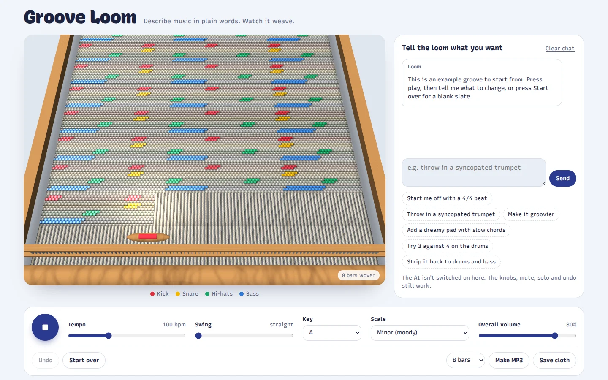

# Groove Loom

**Help me say what I hear.**

Groove Loom is for students and explorers of music: people who want to create with instruments, rhythm and melody, but don't yet have the words to ask for what they hear. You arrive describing music in your own words, and leave able to ask for it in music's words.



## How it teaches

Type what you hear in your head: "start me off with a beat", "make it bouncier", "something sad on top". Each request becomes a layer you hear straight away, and every reply teaches a little:

- **Your words, matched to music's words.** "groovier" → **swing**: every second note lands a little late, so the beat bounces. Next time, you can ask for swing.
- **Your words, kept.** Every word you learn collects in a **Your words** list on your device, with the phrases of yours that led to it. Use one in a later request and it gets a tick; the AI notices, builds on the words you know, and now and then suggests how to ask with them.
- **Exactly what changed.** "Tempo 100 → 110 beats a minute, faster", "+ Trumpet", "Hi-hats: some hits louder than others". The app works this out itself, so it is always accurate.
- **The shape and maths of a pattern.** "3 hits spread as evenly as possible over 8 steps."
- **Patterns you can see.** As the music plays, a loom weaves it into a tapestry. Each layer is a coloured thread, raised wherever that layer sounds, and each bar is a band. Patterns you hear become patterns you can see.
- **Share it.** Share link copies a link to your piece, so someone else can hear it, see how it's woven and change it. The link carries the piece only, never your chat.
- **Hands on.** Knobs shape each layer (volume, tone, space, echo, grit), and rhythm knobs show how hits, steps and rotation build a beat. An "under the hood" panel shows the code that makes the sound, for anyone who wants to go further.

Every feature is held to one test: does it help someone gain a word or a pattern they can use next time?

**Status:** in testing at [www.groove-loom.com](https://www.groove-loom.com). The AI runs on the server behind a shared invite code for testers. Everything else (playback, knobs, the tapestry, MP3 export) works without it.

## Try it locally

Needs Node 22.

```sh
npm install
npm run dev
```

Open http://localhost:5173. The example groove plays and the knobs work straight away.

To switch the AI on, copy `.env.example` to `.env` and fill in an [Anthropic API key](https://console.anthropic.com/) and any invite code you like, then restart `npm run dev` and enter the same code on the page. Requests cost a few cents each; set a spend limit on the key in the Anthropic Console.

## Commands

| Command | What it does |
|---|---|
| `npm run dev` | Front end on port 5173 with hot reload, server on port 8787, both rebuilt on save |
| `npm test` | Unit tests (Vitest) |
| `npm run test:smoke` | Browser tests (Playwright) against a production build; run `npm run build` first, and `npx playwright install chromium` once |
| `npm run lint` | ESLint |
| `npm run typecheck` | TypeScript, for both the front end and the server |
| `npm run build` | Production build into `dist/` |
| `npm start` | Runs the production build (`PORT` sets the port) |

CI runs all of these on every pull request.

## How it works

1. A request goes to the server with the current piece and recent chat. The server asks Claude for a reply that matches a fixed JSON schema.
2. Claude returns a short plain-words explanation and a structured description of the piece: layers, instruments, notes, rhythms and knob values. **It never returns code.**
3. Every field is checked against a whitelist: instruments, keys and scales from fixed lists, numbers clamped, notes and rhythms parsed as [Strudel](https://strudel.cc) mini-notation. Anything else is dropped.
4. The checked piece is compiled into one list of Strudel calls. That list drives both the sound and the "Under the hood" code panel, so the code shown always matches what plays.
5. Strudel plays the pattern in the browser using recorded drums and instruments, and the tapestry weaves each bar from the same pattern.

Why it is built this way, including the trade-offs, is in [docs/design-decisions.md](docs/design-decisions.md).

## Project layout

```
src/
  shared/      Used by both browser and server
    vocabulary.ts    instruments, keys and scales the AI may use
    piece.ts         the piece model and sanitizePiece, the whitelist check
    compiler.ts      piece to Strudel calls and the code listing
    prompt.ts        instructions sent to Claude
    compose-schema.ts  the JSON schema Claude's reply must match
  server/      Hono server: static files, /api/compose, /healthz, rate limits
  web/         Browser app
    ui.ts            chat, layer cards and controls
    audio.ts         Strudel start-up, samples, master volume
    tapestry.ts      the 3D loom (three.js); shaders in tapestry-shaders.ts
    flat-cloth.ts    2D fallback, also used by Save cloth
public/sounds/  Recorded drums and instruments (see CREDITS.md)
e2e/            Browser tests
docs/           Design decisions and deployment
prototype/      The original single-file prototype, kept for reference
```

Unit tests sit beside the code they test (`*.test.ts`).

## Making it your own

The repo is meant to be forked, for another kind of music, another language or another way of seeing sound. Common starting points:

- **Add an instrument:** add an entry to `INSTR` in `src/shared/vocabulary.ts` and put its samples in `public/sounds/`. The AI learns about it automatically, because its instructions are built from that table. Credit the samples in `CREDITS.md`.
- **Change how the AI talks:** edit `INSTRUCTIONS` in `src/shared/prompt.ts`. If you add a field to the piece, add it to `compose-schema.ts`, `sanitizePiece` and the compiler too.
- **Change the look:** colours are CSS variables at the top of `src/web/style.css`; the eight thread colours are `--l0` to `--l7`.
- **Use a different model:** set `ANTHROPIC_MODEL`.

Keep the one rule that holds it together: whatever the AI or a link provides is data, and it goes through `sanitizePiece` before anything uses it.

## Deploying

Any host that runs Node 22 works: `npm run build`, then `npm start`, with `PORT`, `ANTHROPIC_API_KEY` and `INVITE_CODE` set as environment variables. `/healthz` reports the version for health checks.

This repo deploys to Railway: staging from `main` after CI passes, and production from a version tag after approval. The full setup is in [docs/deployment.md](docs/deployment.md).

## More documentation

- [docs/design-decisions.md](docs/design-decisions.md): why things are the way they are
- [docs/deployment.md](docs/deployment.md): the pipeline, releases and hosting setup
- [CONTRIBUTING.md](CONTRIBUTING.md): how to make a change
- [SECURITY.md](SECURITY.md): reporting a problem, and what protects the app
- [CLAUDE.md](CLAUDE.md): the project brief and current state, also read by AI coding assistants

## Credits and licence

- Audio engine: [Strudel](https://strudel.cc), AGPL-3.0.
- Drum samples: [Versilian Community Sample Library](https://github.com/sgossner/VCSL), CC0.
- Instrument samples: Fluid R3 GM by Frank Wen, via [midi-js-soundfonts](https://github.com/gleitz/midi-js-soundfonts), [CC BY 3.0](https://creativecommons.org/licenses/by/3.0/).
- Font: [Recursive](https://www.recursive.design) by Arrow Type, SIL Open Font License 1.1.
- 3D rendering: [three.js](https://threejs.org), MIT.
- MP3 encoding: [lamejs](https://github.com/zhuker/lamejs), LGPL-3.0.

Full sample attribution is in [CREDITS.md](CREDITS.md).

Groove Loom is licensed under the GNU Affero General Public License v3.0 ([LICENSE](LICENSE)), matching Strudel. If you run a modified version for others to use, the AGPL asks you to share its source.
